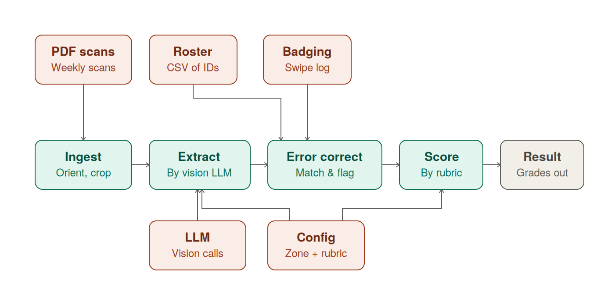

# 17-313 AutoGrader

Turn a stack of scanned student sheets into a graded CSV — one row per page:
who wrote it, what they wrote, and what it scores.

> **This is a stripped-down version of the AutoGrader we use for 17-313.** To
> share it publicly, we redacted student data (every ID and name in the
> examples is made up) and left out some of the features, checks and grading
> policies of the version we run. So if something here doesn't match the blog
> post or seems missing, that is probably why. It is shared to show what
> building something entirely with Claude looks like.

```console
$ VISION_PROVIDER=lmstudio python main.py data/quizzes/2026-09-03-quiz.pdf
ingest: 83/83 pages ready
extract: 83/83 pages read
rematch: 4 of 5 review rows resolved, 1 left
summary: 83 rows, 1 need id review, 4 matched loosely, 0 pages failed
wrote output/quizzes/2026-09-03-quiz.csv
```

```csv
date,page,raw_alias,andrew_id,id_status,q1,q2,bonus,consent,points
2026-09-03,1,jdoe,jdoe,matched,c,a,"Learning with AI is like taking an elevator to the gym...",anonymous,2
```

A new assignment is a **YAML file, not code** — which parts of the page to read,
what to ask about each, and the answer key. Reading and grading are separate
passes, so fixing an answer key re-grades everything in seconds without
re-reading a single image.

## Setup

```bash
pip install -e .            # or: uv sync
brew install tesseract      # system dep: page orientation during ingest
```

The repo ships one sample to run: `data/participation/2026-09-03.pdf`, three
real participation sheets whose AndrewIDs were blanked and rewritten as made-up
ones, with its `config.yaml` and a made-up `data/roster/roster.csv` to match
them against. Its config reads each page in two zones, the ID boxes and the
response, to show how zones work. `data/quizzes/` is empty on purpose.

`logs/` holds sample output from the AutoGrader: the run folder from grading
the sample, with each page as ingest left it, the crops sent to the model, its
raw reads, and the run log.

Then pick a provider. The safest is LM Studio running locally on your Mac:
the scans never leave your machine, and there is no key. Load a vision model in
LM Studio (the default is `qwen/qwen3.8-27b`), start its local server on
`http://127.0.0.1:1234`, then:

```bash
VISION_PROVIDER=lmstudio python main.py data/participation/2026-09-03.pdf
```

Anthropic is the built-in default, so it needs no prefix:

```bash
export ANTHROPIC_API_KEY=sk-ant-...
python main.py data/participation/2026-09-03.pdf
```

Name PDFs with a `YYYY-MM-DD` in them (`2026-09-03.pdf`,
`2026-09-03-quiz.pdf`). The class date comes from the filename, never from the
model, and a file without a real date is rejected.

## Reading the output

`output/` mirrors `data/`, so `data/quizzes/2026-09-03-quiz.pdf` writes
`output/quizzes/2026-09-03-quiz.csv`. Check the `id_status` column — those are
the only rows that normally need you:

| `id_status` | what it means |
|---|---|
| `matched` | confidently this roster id |
| `loose` | resolved on a second pass — worth a glance |
| `manual` | you named this one during the run |
| `dropped` | you said it is not a student's sheet |
| `review` | still not identified; nobody is credited |

Reads are matched against the roster, weighting confusable pairs (`0/o`, `1/l`,
`5/s`) cheaply, so `asmth` still finds `asmith`. No student is ever credited
with two sheets, and an unreadable sheet lands in `review` rather than becoming
a wrong grade. `points` is the auto-scored total only — open responses stay
hand-graded from their transcript column.

## Adding an assignment

Drop the PDF under `data/<area>/` and put a YAML file beside it. The runner
takes `<pdf-stem>.yaml` if it exists, else `config.yaml` in the same folder —
so participation shares one config across every class date, while each quiz
carries its own sidecar.

A config is a list of zones. One zone is one crop of the page and one model
call, and each field it asks for becomes a CSV column:

```yaml
zones:
  - name: sheet                     # one crop, one call, every value on the page
    kind: freetext                  # boxed_id | freetext | bubble - how a read is cleaned
    region: [0.0, 0.0, 1.0, 1.0]    # x, y, w, h as fractions of the page
    fields:
      - andrew_id                   # required exactly once: identity, matched to the roster
      - name: q1
        answer: "c"                 # quote it, or YAML turns no/yes into booleans
        points: 1
      - bonus                       # a bare name is transcribed, not scored
    prompt: |
      Read the whole page. Respond with ONLY a JSON object with the keys
      "andrew_id", "q1" and "bonus". ...
```

Prefer one whole-page zone — the model can return every value from a single
image, so a page costs one call. Split into smaller zones only if a read needs
it.

Ingest finds which way up a page is by OCR'ing the printed header labels, so it
needs to know where they sit on an upright sheet and which words to expect. Two
must match before a rotation is believed, and none may contain another. A page
too faint to read gets a second look in another OCR mode, and failing that takes
the rotation most of the document got. The defaults are the top third and the
participation sheet's labels; a form printed differently says so:

```yaml
orient:
  region: [0.0, 0.0, 1.0, 0.32]   # x, y, w, h - where the labels print
  tokens: ["andrew", "dat", "mm", "dd"]   # lowercase, >= 2, none inside another
```

A form with no date field can never match two of the defaults, so it needs its
own words - the 09-15 quiz uses `["instructions", "andrew", "multiple",
"correct"]` off its instructions line, which took it from 1 page in 12 reading
a header to 12 in 12.

Scoring is data, and reads as three rules:

| the field says | what happens |
|---|---|
| `points: 0` (the default) | transcribed into its column, not scored |
| `points: N` with an `answer` | N points on a case-insensitive match |
| `points: N` with no `answer` | N points if anything was written |

Which field carries the points is a rubric decision. Participation puts them on
`andrew_id`, so the point is for handing a sheet in: the printed ID boxes read
reliably, while a hand-drawn table sometimes transcribes as empty, and a student
should not lose a point to the reader's failure. The response is still
transcribed into its column, just never scored. An unsigned sheet scores nothing.

Every prompt lives in config; there is none in the code. The whole file is
schema-checked before a page renders or a call is spent, so a region running
off the page, a missing prompt or an unquoted `answer` fails immediately rather
than 90 calls later.

**Using sub-page regions?** They are fractions of the *normalized* page, so run
once and check what the model was shown: `logs/<area>/<run>/page-01/` holds the
deskewed page, one PNG per crop, and the verbatim reply. Adjust and re-run.

## How it works



1. **Ingest** — PDF to upright, deskewed page images. No model: deterministic.
2. **Extract** — crop each zone, read it with the zone's prompt. Transcription
   only, no grading.
3. **Cross-reference** — match the ID read against the roster, then give
   whatever is left one looser pass against the students still without a sheet.
4. **Review** — the run pauses and asks you to name the sheets it could not,
   offering only students who have no sheet yet, then re-checks that nobody is
   credited twice. A run with no terminal skips this instead of blocking.
5. **Score** — apply `answer`/`points` to the transcripts.
6. **Validate** — check every row against the CSV header and report what needs
   a human.

Pages run 8 at a time and are cached per page, keyed by PDF content *and* the
zones behind each read: editing a region or prompt re-reads those pages, while
fixing an answer key re-grades cached transcripts with no model calls. A failed
page is logged and dropped from the CSV rather than cached, so re-running picks
up exactly that page. `logs/` is safe to delete.

Each run's `run.log` ends with a summary — wall time, model calls and tokens,
and how many rows need a human — and every stage logs its own time. A re-run
that reports 0 model calls did all its reading from the cache.

`CLAUDE.md` has the full design.

## Providers

Only the provider you use needs its SDK and key at runtime.

| Provider | Key | Default model |
|---|---|---|
| `anthropic` (default) | `ANTHROPIC_API_KEY` | `claude-opus-4-8` |
| `openai` | `OPENAI_API_KEY` | `gpt-5.6` |
| `gemini` | `GEMINI_API_KEY` | `gemini-3.8-flash` |
| `openrouter` | `OPENROUTER_API_KEY` | `minimax/minimax-m3:free` |
| `lmstudio` | none — a local server | `qwen/qwen3.8-27b` |
| `bedrock` | AWS credentials (profile, SSO, environment, or IAM role) | `qwen.qwen3-vl-235b-a22b` |

Override per run, or change the default in `pipeline/config.py`:

```bash
VISION_PROVIDER=gemini python main.py <pdf>
VISION_PROVIDER=lmstudio VISION_MODEL=<a model loaded in LM Studio> python main.py <pdf>
```

`openrouter` fronts every vendor behind one key, so any vision-capable model on
[openrouter.ai/models](https://openrouter.ai/models) works by id. Its default is
free but rate limited, so a run backs off and takes longer. `lmstudio` talks to
a local LM Studio server: no key, no network, fully offline. Model names move
fast — confirm an id against your provider's current lineup.

### Amazon Bedrock

Install the updated dependencies (`uv sync` or `pip install -e .`). Bedrock
uses Boto3's standard AWS credential chain; no Anthropic API key is needed.

We run it with a Bedrock API key. `.env.bedrock.example` holds the settings we
use: copy it to `.env.bedrock` (gitignored), paste your key, then
`source .env.bedrock && python main.py data/participation/2026-09-03.pdf`.

For an existing AWS SSO profile instead:

```bash
aws sso login --profile my-profile
export AWS_PROFILE=my-profile
export AWS_DEFAULT_REGION=us-east-1
export VISION_PROVIDER=bedrock
unset VISION_MODEL  # use the default Qwen3 VL 235B A22B
python main.py data/participation/2026-09-03.pdf
```

The default is [Qwen3 VL 235B A22B](https://docs.aws.amazon.com/bedrock/latest/userguide/model-card-qwen-qwen3-vl-235b-a22b.html),
using its `bedrock-runtime` ID `qwen.qwen3-vl-235b-a22b`. It supports image input
and Converse in `us-east-1`, among other regions. To use another model, set
`VISION_MODEL` to a vision model ID or inference profile ID/ARN supported by
[Bedrock Converse](https://docs.aws.amazon.com/boto3/latest/reference/services/bedrock-runtime/client/converse.html)
in your region. Your AWS identity needs `bedrock:InvokeModel` access to the
selected model, including the profile and destination models when using
[cross-region inference](https://docs.aws.amazon.com/bedrock/latest/userguide/inference-profiles-prereq.html).
Complete any required [model access setup](https://docs.aws.amazon.com/bedrock/latest/userguide/model-access.html)
in the account first.

`AWS_REGION` takes precedence over `AWS_DEFAULT_REGION`; otherwise Boto3 uses
the region in your AWS profile. Environment credentials (`AWS_ACCESS_KEY_ID`,
`AWS_SECRET_ACCESS_KEY`, and `AWS_SESSION_TOKEN` for temporary credentials) and
IAM roles work too. Configure credentials locally, not in source files.

To test access with a small generated image, without touching PDF caches or CSVs:

```bash
python - <<'PY'
from PIL import Image, ImageDraw
from pipeline import vision

image = Image.new("RGB", (240, 100), "white")
ImageDraw.Draw(image).text((20, 40), "BEDROCK OK", fill="black")
print(vision.read_image(image, "Transcribe the text in this image.", max_tokens=128))
print(vision.usage())
PY
```

This makes a billed model request using the environment above. For a full
pipeline test, use an uncached test PDF with its YAML config. The existing
cache does **not** distinguish providers or models, so switching to Bedrock
on an already cached PDF can result in zero API calls. The CSV output path
also stays the same across providers.

## Tests

```bash
python -m unittest discover -s tests -t . -v
```

No API key or network needed (~1m, since ingest sweeps OCR over four rotations
per page, twice for a page the first mode can't read). They cover ingest
determinism — what the cache depends on — and the rules that matter for
grading: an unidentifiable sheet is never credited to a student, and no student
is credited with two sheets.

## Layout

```
data/<area>/     scans + the YAML config describing them
data/roster/     roster.csv — AndrewIDs and their Canvas identity
output/<area>/   <stem>.csv (results) + <stem>-canvas.csv (Canvas upload)
logs/            per-run debug trail: page images, crops, raw reads (the sample's is committed)
pipeline/        config.py ingest.py extract.py roster.py review.py canvas.py
                 vision.py runner.py
main.py          CLI: python main.py <pdf_path>
autograder.png   the pipeline diagram above
```

## A note on the data

The only student work in this repo is the three sample sheets, and their
AndrewIDs were replaced with made-up ones. Everything else under `data/` and `logs/`, and
all of `output/`, is gitignored, so your scans, roster and results stay on your
machine. The test scan in `tests/fixtures/` is synthetic, and the ids in the
tests are made up.

## License

MIT — see [LICENSE](LICENSE).
